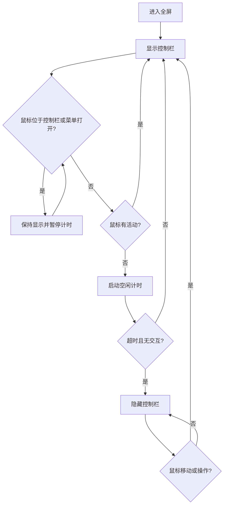

# PotPlayer 交互分析与 LNPlayer Windows 视频界面需求

状态：需求基线，待实现和验收。  
适用范围：LNPlayer Windows 视频模式（Qt 6 Widgets）。  
目标：参考 PotPlayer 成熟的交互模式，不复制其品牌、皮肤或全部功能。

## 1. 目标与边界

LNPlayer 应以视频画面为中心，提供控制栏、键盘、鼠标、右键菜单等多入口操作。高频操作无需打开设置；低频和高级功能通过分层菜单及独立设置窗口访问。

本需求仅覆盖 Windows 视频播放、播放队列、视频画面控制、视频内音轨、字幕、快捷键、鼠标交互、OSD 和设置。视频文件内音轨的选择、音量和静音属于视频播放配套能力。

不纳入：独立音乐库/音乐模式、在线媒体服务、电视/摄像头/光盘采集、直播推流、皮肤市场/插件生态、多端同步和跨设备控制。

## 2. PotPlayer 交互模式分析

### 2.1 多入口命令系统
常用操作可以通过控制栏、快捷键、鼠标或右键菜单触发；同一命令具有多个入口。LNPlayer 必须建立统一命令语义，所有入口调用同一命令处理逻辑，避免按钮、快捷键和菜单状态不一致。

### 2.2 主窗口与辅助窗口分离
视频画面是主工作区；播放列表、控制面板、偏好设置和播放信息可以独立显示。LNPlayer 应采用主播放窗口 + 可收起队列侧栏/独立队列窗口 + 独立设置窗口的结构。全屏时不强制显示辅助面板。

### 2.3 命令分层
- 高频：播放/暂停、定位、音量、全屏、上一项/下一项。
- 中频：字幕/音轨切换、倍速、画面比例、逐帧。
- 低频：滤镜参数、色彩、高级字幕样式、解码/渲染信息。

高频命令直接可见或有稳定快捷键；中频命令放入菜单；低频命令放入设置窗口。

### 2.4 可配置性
PotPlayer 支持快捷键和鼠标行为配置。LNPlayer 先提供稳定默认映射，再提供快捷键重映射、冲突检测和鼠标行为配置。控件是否显示与命令是否可用必须分离。

### 2.5 操作反馈
通过 OSD/状态信息反馈定位、音量、倍速、播放信息等操作。LNPlayer 对没有明显控件状态变化的命令提供短暂 OSD；错误和不可执行状态必须说明原因。

## 3. 信息架构

### 3.1 主播放窗口
1. 标题区域：当前媒体名称和窗口控制。
2. 视频画布：主要显示区域；无媒体时显示空状态和打开文件入口。
3. 进度区域：当前时间、总时长、进度滑块、章节/书签标记（有数据时）、悬停时间提示。
4. 控制区域：上一项、播放/暂停、停止、下一项、时间、音量/静音、队列入口、全屏入口。
5. 队列侧栏：可展开/收起，显示当前项和播放顺序。
6. OSD 层：音量、定位、倍速、比例、字幕/音轨切换等临时反馈。

控制栏保持紧凑，不承载全部高级功能。窗口缩小时优先压缩次要信息，核心播放按钮必须可访问。

### 3.2 菜单结构
主菜单与右键菜单共享命令定义。右键菜单只显示当前上下文相关操作，当前选项显示勾选状态，不可用操作明确禁用。

- 文件：打开文件、打开文件夹、最近播放、关闭当前媒体、退出。
- 播放：播放/暂停、停止、上一项/下一项、跳转、逐帧、倍速、循环、随机。
- 视频：比例、适应/缩放、旋转/翻转、滤镜、截图、视频信息。
- 字幕：内嵌字幕、加载外挂字幕、启用/禁用、同步、样式。
- 音轨：当前视频内音轨选择、音量、静音。
- 播放列表：显示/隐藏、添加、移除、清空、排序、随机顺序。
- 设置：偏好设置、快捷键、播放信息。

菜单项显示快捷键提示。右键菜单不应成为所有高级设置的唯一入口。

### 3.3 辅助窗口
- 播放列表：队列项、当前项高亮、时长（可获得时）、添加/移除/清空、拖动排序、双击播放。
- 设置：常规、播放、界面、视频、字幕、快捷键、性能/解码信息。
- 播放信息：容器、视频流、音轨、字幕流、编码、分辨率、帧率、色彩信息、硬件解码状态；仅展示实际可获取的数据。
- 同类窗口重复打开时聚焦已有窗口，不创建多个冲突实例。

## 4. 详细需求

优先级：P0 = 基础交互必须完成；P1 = 高质量桌面体验；P2 = 高级定制。

### 4.1 主界面与窗口
| ID | 优先级 | 需求 | 验收标准 |
|---|---|---|---|
| UI-001 | P0 | 视频画布为主工作区 | 缩放窗口时画布正确调整 |
| UI-002 | P0 | 空状态 | 无媒体时有明确提示和打开入口 |
| UI-003 | P0 | 播放状态显示 | 加载/播放/暂停/停止/结束与实际状态一致 |
| UI-004 | P0 | 错误状态 | 打开失败、解码失败、无视频流有可读提示 |
| UI-005 | P0 | 比例适配 | 默认保持宽高比，除非用户选择拉伸 |
| UI-006 | P0 | 全屏切换 | 按钮、菜单、快捷键均可切换，退出恢复窗口几何状态 |
| UI-007 | P1 | 全屏控制栏自动隐藏 | 鼠标移动显示，空闲后隐藏，鼠标在控制栏内时不隐藏 |
| UI-008 | P1 | 底边唤出控制栏 | 鼠标移动至屏幕底边可唤出 |
| UI-009 | P1 | 双击画面切换全屏 | 控件双击不误触发画面双击 |
| UI-010 | P1 | Esc 退出全屏 | 先关闭弹出层，再退出全屏，不退出应用 |
| UI-011 | P1 | 置顶开关 | 状态可见并持久化 |
| UI-012 | P2 | 控制栏自定义 | 可隐藏非必要按钮，但对应命令仍可使用 |

### 4.2 播放与定位
| ID | 优先级 | 需求 | 验收标准 |
|---|---|---|---|
| PB-001 | P0 | 播放/暂停/停止 | 按钮、快捷键、菜单行为一致 |
| PB-002 | P0 | 上一项/下一项 | 与队列顺序和边界规则一致 |
| PB-003 | P0 | 拖动进度条定位 | 拖动显示目标时间，释放提交定位 |
| PB-004 | P0 | 点击进度条定位 | 点击位置转换为目标媒体时间 |
| PB-005 | P0 | Seek 状态反馈 | 显示定位中，完成后显示实际位置，旧请求不能覆盖新请求 |
| PB-006 | P0 | 时间显示 | 当前时间/总时长格式统一，未知时长明确显示 |
| PB-007 | P0 | 分级快进/快退 | 支持多个跳转间隔 |
| PB-008 | P0 | 逐帧前进/后退 | 操作后暂停，时间对应目标帧 PTS |
| PB-009 | P0 | 倍速 | 减速、加速、恢复正常，显示当前速度 |
| PB-010 | P0 | 播放完成行为 | 停止、下一项、循环按设置执行 |
| PB-011 | P1 | 进度悬停预览 | 显示目标时间；缩略图仅在能力可用时显示 |
| PB-012 | P1 | 章节/书签 | 有数据时显示标记并支持跳转 |
| PB-013 | P1 | 记忆播放位置 | 按设置记忆并恢复上次位置 |
| PB-014 | P2 | A-B 循环 | 设置 A/B 点、清除和状态反馈 |

### 4.3 鼠标
| ID | 优先级 | 需求 | 验收标准 |
|---|---|---|---|
| MS-001 | P0 | 左键画布 | 默认不改变播放状态；可配置 |
| MS-002 | P0 | 右键画布 | 打开上下文菜单 |
| MS-003 | P0 | 控件点击 | 不被画布操作拦截 |
| MS-004 | P0 | 进度条拖动 | 释放后提交最终定位，不重复提交中间位置 |
| MS-005 | P1 | 双击画布 | 切换全屏 |
| MS-006 | P1 | 滚轮音量 | 画布滚轮调节音量并显示 OSD |
| MS-007 | P1 | Ctrl+滚轮缩放 | 仅在画布生效，不干扰列表滚动 |
| MS-008 | P1 | 中键行为 | 默认全屏切换或无动作，允许配置 |
| MS-009 | P1 | 鼠标空闲检测 | 全屏控制栏能及时唤出/隐藏 |
| MS-010 | P2 | 鼠标手势 | 右键拖动方向可映射命令；执行手势后不再弹出右键菜单 |
| MS-011 | P2 | 鼠标按键映射 | 支持可识别的侧键等鼠标按键 |

### 4.4 键盘快捷键
快捷键必须集中管理，禁止在多个 QWidget 中重复硬编码。输入框、队列和菜单获得焦点时，文本编辑/列表/菜单导航优先，不得被全局播放快捷键抢占。

建议默认映射（实施时需与现有按键逐项冲突审查）：

| 按键 | 命令 | 优先级 |
|---|---|---|
| Space | 播放/暂停 | P0 |
| Left / Right | 后退/前进 5 秒 | P0 |
| Ctrl+Left / Ctrl+Right | 后退/前进 30 秒 | P1 |
| PageUp / PageDown | 上一项/下一项 | P0 |
| Up / Down | 音量增加/降低 | P0 |
| M | 静音切换 | P0 |
| Enter | 全屏切换 | P0 |
| Esc | 退出全屏/关闭当前浮层 | P0 |
| F3 或 Ctrl+O | 打开文件 | P0 |
| F5 | 设置 | P1 |
| F6 | 显示/隐藏播放列表 | P0 |
| F7 | 播放信息/控制面板 | P1 |
| D / F | 上一帧/下一帧 | P0 |
| X / C / Z | 减速/加速/正常速度 | P1 |
| K | 截图 | P1 |
| Alt+O | 加载外挂字幕 | P1 |
| Tab | 播放信息 OSD | P1 |
| Ctrl+T | 置顶切换 | P2 |

要求：可查看完整映射；可添加/修改/删除；冲突时显示冲突命令并允许取消或显式替换；可恢复默认；全局媒体键预留但默认不启用。不得破坏现有逗号/句号逐帧等已公开操作。

### 4.5 播放列表
| ID | 优先级 | 需求 | 验收标准 |
|---|---|---|---|
| PL-001 | P0 | 显示/隐藏队列 | 控制栏、菜单、快捷键均可访问 |
| PL-002 | P0 | 当前项高亮 | 当前播放项始终清晰可见 |
| PL-003 | P0 | 双击播放 | 双击队列项切换播放 |
| PL-004 | P0 | 添加文件/文件夹 | 支持多选和文件夹导入 |
| PL-005 | P0 | 拖放添加 | 文件拖入画布/队列行为明确 |
| PL-006 | P0 | 删除队列项 | 当前项删除后的后续行为明确 |
| PL-007 | P0 | 队列排序 | 拖动、上移、下移 |
| PL-008 | P0 | 随机播放 | shuffle 顺序稳定，关闭后恢复原始顺序 |
| PL-009 | P0 | 循环模式 | 列表循环、单项循环、关闭循环 |
| PL-010 | P1 | 清空队列 | 队列非空时提供合理确认 |
| PL-011 | P1 | 队列上下文菜单 | 播放、移除、定位文件、信息 |
| PL-012 | P1 | 文件信息列 | 文件名、时长；可获得时显示分辨率/大小 |
| PL-013 | P1 | 最近播放 | 文件菜单可访问 |
| PL-014 | P1 | 队列持久化 | 按设置恢复队列、索引、随机/循环状态 |
| PL-015 | P1 | 独立播放列表窗口 | 与主队列共享数据模型；可重复打开聚焦；双击播放、拖动排序、添加、批量移除、清空 |

### 4.6 视频画面
| ID | 优先级 | 需求 | 验收标准 |
|---|---|---|---|
| VD-001 | P0 | 比例 | 原始、适应窗口、16:9、4:3、拉伸 |
| VD-002 | P0 | 缩放/平移 | 可恢复默认，不意外超出画布 |
| VD-003 | P0 | 旋转 | 0/90/180/270 度，软硬解结果一致 |
| VD-004 | P0 | 水平/垂直翻转 | 菜单和 OSD 状态正确 |
| VD-005 | P0 | 基础滤镜 | 亮度、对比度、饱和度、色调、锐化、降噪、灰度 |
| VD-006 | P0 | 重置画面 | 一键恢复变换和色彩参数 |
| VD-007 | P1 | 滤镜面板 | 实时预览、数值可见、单项/全部重置 |
| VD-008 | P1 | 截图 | 保存当前帧并反馈成功/失败 |
| VD-009 | P1 | 截图目录 | 可配置默认目录和命名规则 |
| VD-010 | P1 | 色彩/HDR 信息 | 显示可获取的源色彩和输出处理状态 |
| VD-011 | P1 | 播放信息 | 分辨率、帧率、编码、码率（可获得时）、硬件解码状态 |
| VD-012 | P2 | 可组合滤镜链 | 处理顺序明确，字幕/色彩顺序可预测 |

### 4.7 字幕
| ID | 优先级 | 需求 | 验收标准 |
|---|---|---|---|
| SU-001 | P0 | 内嵌字幕选择 | 显示语言、标题、格式等轨道信息 |
| SU-002 | P0 | 外挂字幕加载 | 文件选择和拖放加载 |
| SU-003 | P0 | 启用/禁用 | 禁用后无旧字幕残留 |
| SU-004 | P0 | 同步调整 | 延迟调整和恢复默认，内嵌/外挂一致 |
| SU-005 | P1 | 自动匹配外挂字幕 | 同目录同名匹配，不覆盖用户显式选择 |
| SU-006 | P1 | 字幕轨道记忆 | 按媒体记忆选择 |
| SU-007 | P1 | 字幕样式 | 字体、字号、颜色、描边/阴影、位置、边距 |
| SU-008 | P1 | 样式预览 | 调整时实时预览 |
| SU-009 | P1 | 字幕快捷操作 | 显示/隐藏、轨道切换、同步微调 |
| SU-010 | P2 | ASS/SSA 高级样式 | 支持时遵循格式语义；不支持时明确提示 |

### 4.8 视频内音轨
| ID | 优先级 | 需求 | 验收标准 |
|---|---|---|---|
| AU-001 | P0 | 音轨列表 | 语言、标题、编码、声道数、采样率、默认轨 |
| AU-002 | P0 | 音轨切换 | 切换后无旧轨残留 |
| AU-003 | P0 | 音量/静音 | 控制栏、滚轮、快捷键统一并显示 OSD |
| AU-004 | P1 | 音轨记忆 | 按媒体记住选择 |
| AU-005 | P1 | 无音轨状态 | 明确显示无音轨，不生成空菜单项 |

### 4.9 OSD 与错误反馈
| ID | 优先级 | 需求 | 验收标准 |
|---|---|---|---|
| FB-001 | P0 | 命令 OSD | 音量、静音、倍速、定位、比例有短暂反馈 |
| FB-002 | P0 | 播放状态 | 加载、播放、暂停、定位、结束可辨认 |
| FB-003 | P0 | 错误提示 | 有错误摘要和可执行建议 |
| FB-004 | P0 | 非阻塞反馈 | 常规命令不频繁弹模态框 |
| FB-005 | P1 | OSD 设置 | 显示时长、位置、显示项可配置 |
| FB-006 | P1 | 解码状态 | 展示硬件解码、软件回退和渲染状态 |
| FB-007 | P1 | 状态一致性 | OSD、菜单勾选、按钮与 Core 状态一致 |

### 4.10 设置与持久化
设置窗口采用左侧分类导航、右侧设置页、底部应用/确定/取消/恢复默认。普通设置立即生效；需要重建解码器/渲染器的设置提示生效时机。

| ID | 优先级 | 需求 | 验收标准 |
|---|---|---|---|
| ST-001 | P0 | 设置入口 | 菜单和快捷键可打开 |
| ST-002 | P0 | 设置持久化 | 重启恢复已保存设置 |
| ST-003 | P1 | 常规页 | 启动、播放完成、记忆位置 |
| ST-004 | P1 | 界面页 | 控制栏、OSD、队列、全屏自动隐藏 |
| ST-005 | P1 | 视频页 | 比例、旋转、滤镜、截图目录 |
| ST-006 | P1 | 字幕页 | 字体、字号、颜色、位置、默认同步 |
| ST-007 | P1 | 快捷键页 | 查看、修改、冲突检测、恢复默认 |
| ST-008 | P1 | 性能页 | 仅显示/配置当前实际支持的解码和渲染选项 |
| ST-009 | P1 | 恢复默认 | 当前分类或全部设置可恢复 |
| ST-010 | P2 | 导入/导出 | 配置格式有版本号并校验兼容性 |

## 5. 关键交互状态

### 5.1 全屏控制栏
默认自动隐藏延迟建议 2 秒。进入全屏先显示控制栏；鼠标移动或底边唤出时显示并重新计时；鼠标位于控制栏或菜单打开期间暂停隐藏计时；空闲超时后隐藏。隐藏控制栏不得改变播放状态，快捷键仍可用。

### 5.2 队列规则
- 双击队列项播放；单击只选中。
- 删除非当前项不影响播放；删除当前项时按队列策略切换下一项；队列为空则进入空状态。
- 随机模式保留可预测的历史导航，上一项返回刚播放过的项目。
- 手动上一项/下一项和自动播放下一项共用队列模型，但边界行为必须明确。

### 5.3 焦点规则
- 播放画布获得焦点时启用播放器快捷键。
- 文本输入框、快捷键录入框、队列搜索框获得焦点时，文本编辑优先。
- 菜单打开时方向键用于菜单导航。
- Esc 按层级关闭菜单/浮层，再退出全屏，不退出应用。
- 辅助窗口打开不能导致快捷键随机失效。

### 5.4 状态一致性
UI 不自行推断播放状态，以 Core 状态快照/事件为准。Seek 使用 generation 防止旧请求覆盖新请求。媒体切换时清理旧媒体 OSD、字幕预览、帧历史和临时选择。错误提示应包含媒体名称、失败阶段和建议，详细技术信息可展开查看。

## 6. 视觉与可用性
- 默认深色主题；文字、控件状态有足够对比度。
- 图标、尺寸、间距、圆角、禁用状态统一。
- 播放/暂停、静音、全屏、随机、循环等状态按钮区分开启/关闭。
- 悬停显示 tooltip，必要时包含快捷键。
- 进度条、音量滑块、菜单支持键盘访问。
- 高 DPI 和 Windows 显示缩放下不得裁切。
- 控制栏/OSD 不应长时间遮挡字幕。
- 动画简短，不引入高频线程，不影响视频帧呈现。

## 7. 实施阶段

### Phase 1：基本交互闭环（P0）
统一命令入口和状态同步；主画布、控制栏、进度条、状态/错误反馈；基础快捷键、右键菜单；队列显示、增删、排序、导航、随机/循环；视频比例、逐帧、倍速、音轨/字幕入口；全屏切换和窗口几何恢复。

### Phase 2：PotPlayer 风格体验（P1）
全屏控制栏自动隐藏/底边唤出；双击全屏、滚轮音量；独立队列窗口/侧栏；设置窗口和分类页；OSD 完整化、播放信息窗口；字幕样式、滤镜精细控制、播放位置记忆；进度悬停预览。

### Phase 3：高级定制（P2）
快捷键重映射、冲突检测；鼠标手势/按键映射；控制栏自定义；章节/书签、A-B 循环、高级滤镜链；设置导入/导出。

## 8. Mermaid：全屏控制栏状态流程

## 9. 验收场景

1. 无媒体启动：空状态正确，打开入口可用。
2. 打开视频：加载状态、首帧、标题、总时长正确。
3. 播放/暂停/停止：按钮、快捷键、菜单一致。
4. 连续拖动进度条：只提交合理定位请求，最终位置正确。
5. 连续快进/快退：最终位置与最后一次操作一致。
6. 逐帧：暂停状态和 PTS 时间显示一致。
7. 切换队列项：旧字幕、旧帧、旧 OSD 不残留。
8. 随机/循环/上一项/下一项：顺序符合定义。
9. 全屏自动隐藏：移动唤出、空闲隐藏、控制栏内停留不隐藏。
10. 双击画面：全屏切换；双击控件不触发。
11. 滚轮：仅在画布调整音量，不干扰列表滚动。
12. 右键菜单：上下文命令和勾选状态正确。
13. 内嵌/外挂字幕：切换、禁用、延迟和样式正确。
14. 视频多音轨：切换后轨道信息和播放声音同步。
15. 比例/旋转/滤镜：软硬解结果一致。
16. 设置重启后持久化；辅助窗口不重复创建。
17. 输入框聚焦时快捷键不抢占文本。
18. 损坏文件/无视频流：错误明确，应用仍可打开其他媒体。
19. 高 DPI、多显示器、最大化/恢复/全屏切换正常。
20. 播放中关闭窗口：播放器生命周期安全结束，不冻结 UI。

## 10. 当前实现映射（初步盘点）

以下是基于当前代码结构和已有开发记录的初步映射，不代表已完成 Windows 运行验收。

| 领域 | 已有基础 | 主要缺口/待审查 |
|---|---|---|
| 主界面 | Qt Widgets、VideoSurface | 统一视觉规范、空/加载/错误状态 |
| 播放控制 | 播放/暂停/停止、Seek、队列导航 | 状态反馈和快捷键集中管理 |
| 鼠标 | 拖放、右键菜单 | 双击全屏、滚轮、空闲检测、手势 |
| 全屏 | 基础切换 | 自动隐藏和底边唤出 |
| 队列 | 增删/排序、随机/循环、持久化、独立队列窗口、批量操作 | 文件时长/分辨率列、拖动反馈和完整运行验收 |
| 视频控制 | 比例、滤镜、旋转、截图基础能力 | 设置面板、实时预览、菜单状态同步 |
| 字幕 | 内嵌/外挂、启停、同步基础交互 | 字体/字号/颜色/位置配置和预览 |
| 视频内音轨 | 枚举和切换 | UI 状态、记忆选择、错误反馈 |
| OSD | 部分状态提示 | 统一样式、时长/位置配置 |
| 设置 | QSettings 部分持久化 | 独立设置窗口、分类和快捷键管理 |
| 播放信息 | 基础媒体状态信息 | 独立信息窗口和硬件解码信息 |

## 11. 参考资料

PotPlayer 不同版本、皮肤和用户配置可能改变菜单名称、快捷键和鼠标默认行为；以下资料用于归纳交互模式，最终应以当前正式版本实测为准。

1. 快捷键分类（播放、字幕、视频、画面尺寸）：https://potplayer.multimediaplayer.net/tutorials/shortcuts/
2. 帮助问答（快捷键设置、截图）：https://potplayer.one/en/help/
3. 鼠标交互评测（左键、右键、双击、中键、滚轮）：https://www.virtualcuriosities.com/articles/5067/my-review-of-potplayer
4. 菜单层级示例（全屏、设置、播放列表、控制面板）：https://www.blankom.de/assets/downloads/Encoder-4K60-HDR-Settings-Guide.pdf
5. 配置项示例（播放位置记忆、队列、字幕、鼠标设置）：https://github.com/Onemeshnik/PotPlayer-Median-subtitles-installer/blob/master/PotPlayer64.iss

---

需求状态：需求基线持续跟踪中。独立播放列表窗口已进入实现；其他条目以 docs/VIDEO_COMPLETION.md 的逐项记录为准。所有条目仍须区分源码审查、构建验证和 Windows 实际交互验证。

## 12. LNPlayer 实施进度（2026-11-21）

本节是需求追踪摘要，详细提交和逐项状态以 docs/VIDEO_COMPLETION.md 为准。

### 已落地的主要交互

- 主窗口深色控件主题、空/加载/错误状态、OSD 和播放信息窗口。
- 顶层文件、播放、视频、字幕、音轨、播放列表、设置菜单；右键上下文菜单。
- 全屏控制栏空闲自动隐藏、鼠标移动唤出、菜单/模态对话框期间暂停隐藏计时。
- 播放/暂停/停止、队列导航、进度定位、悬停时间提示、逐帧、倍速、A-B 循环。
- 播放列表侧栏、文件夹导入、拖放追加、多选批量删除、右键操作、随机/循环、最近播放和持久化。
- 23 个可配置快捷键、焦点保护、冲突检测和持久化。
- 音轨/内嵌字幕轨道选择、每媒体轨道记忆、外挂字幕加载/自动匹配/手动路径记忆。
- 字幕字体、字号、颜色、位置和时间偏移设置。
- 视频比例、旋转/翻转、基础滤镜参数、截图和截图目录记忆。
- 窗口几何状态、置顶、播放位置记忆、中键行为、右键拖动手势。

### 仍未完成或仅部分完成

- 进度缩略图、章节/书签导航。
- Ctrl+滚轮画面缩放；当前滚轮用于音量，中键和右键手势已有基础行为。
- 播放列表分辨率/时长列、独立队列窗口、递归文件夹扫描和拖动插入位置提示。
- HDR 高级元数据、完整媒体编码/帧率/码率信息、硬件解码器和丢帧统计。
- 字幕实时预览、完整 ASS/SSA 样式控制、复杂字幕特效和更多样式参数。
- OSD 图标化、控制栏元素自定义、快捷键菜单提示动态同步。
- 鼠标手势映射自定义、设置导入/导出、滤镜链自定义。
- 章节/书签、跨显示器/DPI 变化的完整窗口恢复验收。

### 验证状态

当前已完成 GitHub 源码静态审查和基础结构检查；尚未完成 Windows CMake 构建、Qt UI 自动化测试及 Windows 实机交互验收。未验证项不得标记为交付完成。
